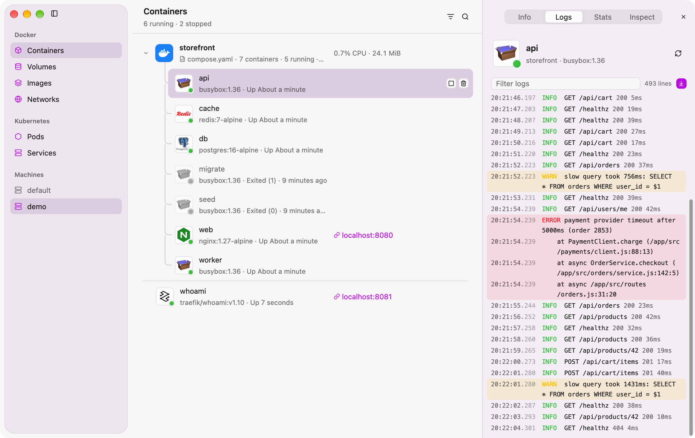
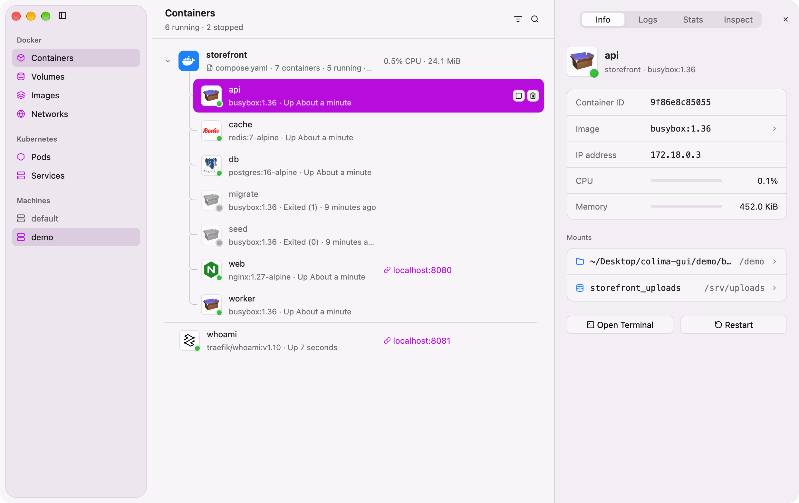
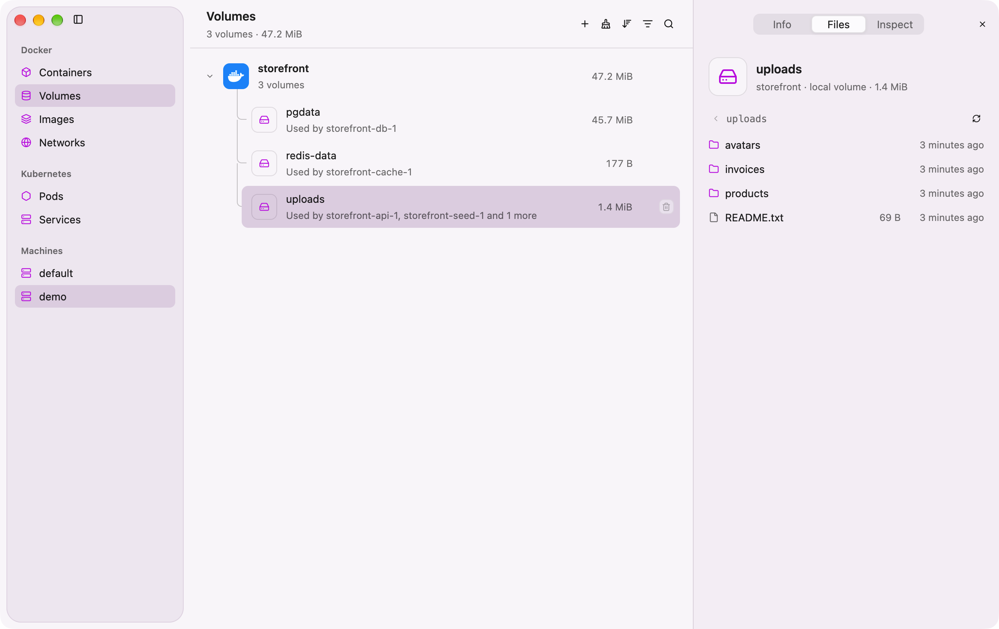
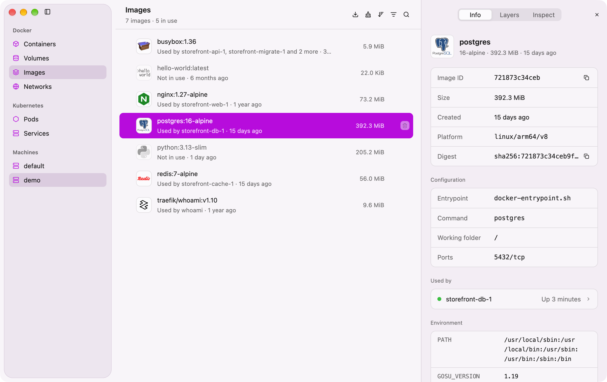
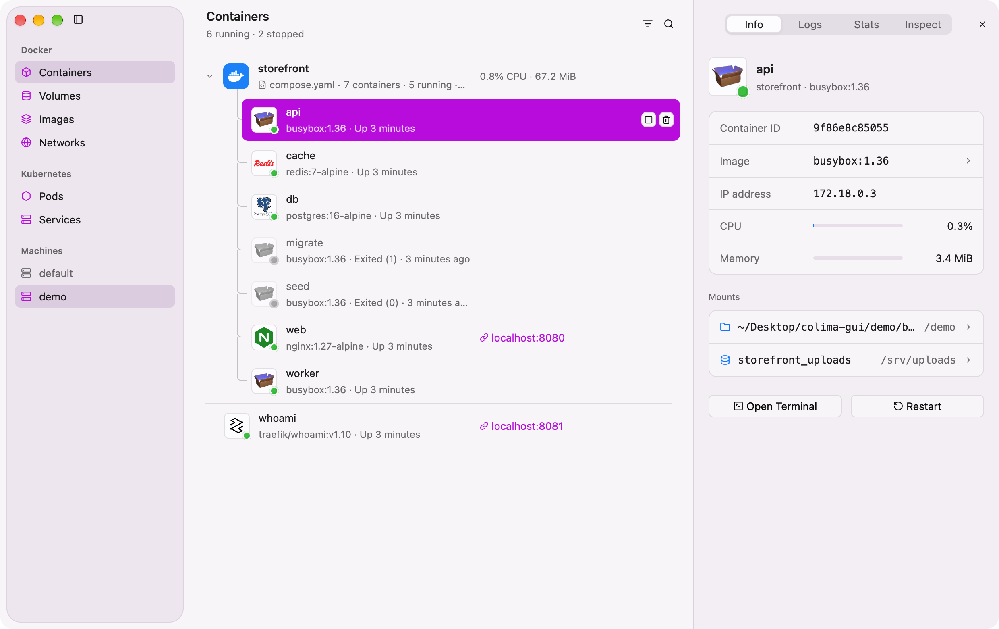
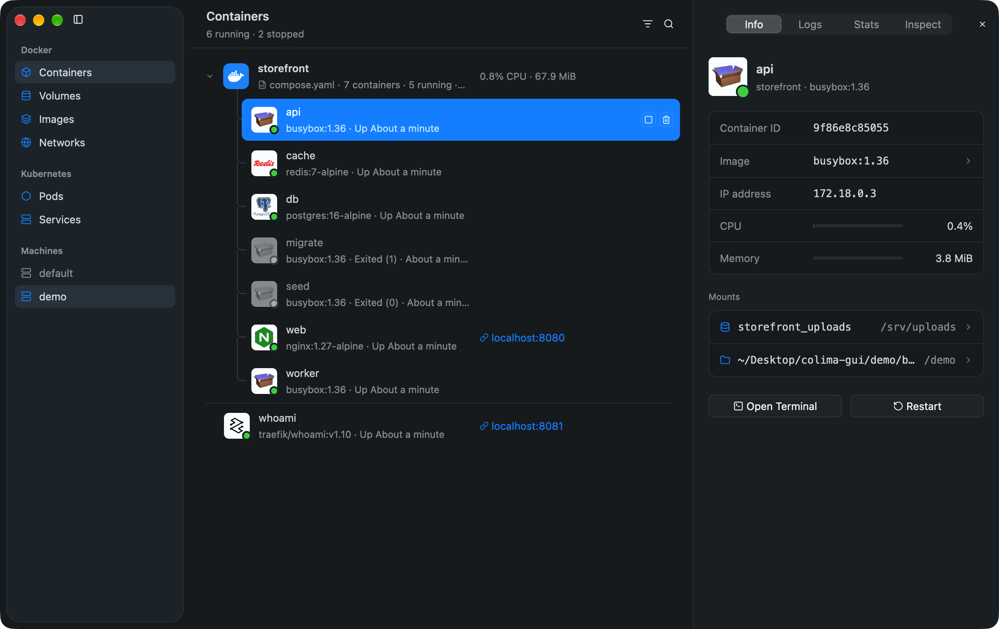
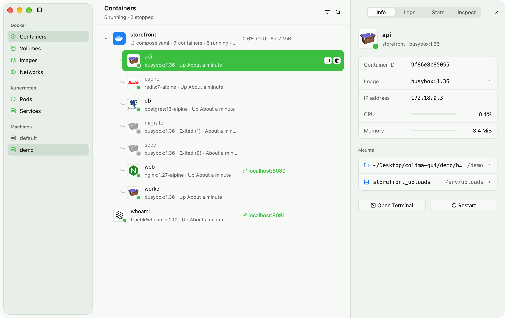
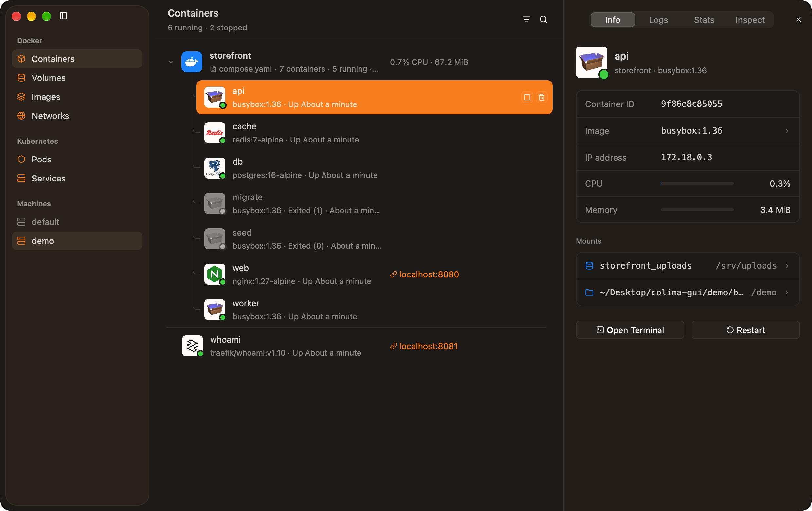

# Colima GUI

A native macOS app for [Colima](https://github.com/abiosoft/colima). Use it to
manage your containers, volumes, images, and Colima machines. It uses Rust and
[GPUI](https://www.gpui.rs), and it connects to the Docker engine of Colima
through the Unix socket.



## Features

- **Containers**: The app groups the containers by Compose project. Start,
  stop, restart, and remove a container or a full project. The detail pane
  shows the information, the live logs, the CPU and memory use, and the inspect
  data.
- **Logs**: The log view keeps the colors of the output. It finds the level of
  each line (JSON, `key=value`, and plain text), and it makes the links
  clickable.
- **Volumes**: See the size of each volume and the containers that use it.
  Look at the files in a volume.
- **Images**: Pull, remove, and prune images. See the layers, the
  configuration, and the containers that use each image.
- **Machines**: Start, stop, and change between Colima profiles.
- **Menu bar**: Control your containers from the menu bar.
- **Keyboard**: Use the keyboard to move through all the areas of the window.

## Screenshots

| Containers | Volume files |
| --- | --- |
|  |  |

| Images |
| --- |
|  |

The screenshots show the sample data in [`demo/`](demo). See
[Sample data for a demo](#sample-data-for-a-demo).

## Themes

The app follows the light or dark appearance of macOS. To change the accent
color, use the **View** menu. The default accent color is Teal. Select
**System** to use the accent color from System Settings. The app keeps your
choice between launches.


| Purple, light | Blue, dark |
| --- | --- |
|  |  |

| Green, light | Orange, dark |
| --- | --- |
|  |  |

The other accent color is Pink.

## Install

Download the `.pkg` file for your Mac from the
[latest release](https://github.com/sam-ayo/colima-gui-releases/releases/latest).
The installer puts **Colima GUI** in `/Applications`. The app contains the
Colima, Lima, and Docker command line tools. The installer links a tool into
`/usr/local/bin` only if that tool is not already installed. The app installs
its updates itself.

## Build from source

You need Rust (edition 2024) and the Xcode command line tools.

```sh
cargo run
```

The app finds the Docker socket in this order: `DOCKER_HOST`, then
`~/.colima/default/docker.sock`, then `colima status`.

To make an installer package, use `scripts/package.sh`.

## Sample data for a demo

The [`demo/`](demo) folder contains a small web shop Compose stack. It fills
the app with realistic data:

- A `storefront` project with a web server, an API, a worker, PostgreSQL, and
  Redis.
- Logs with colored level words, JSON lines, `key=value` lines, and a stack
  trace.
- A failed migration job, and a seed job that exits with code 0.
- Three named volumes. The `uploads` volume contains sample files.
- A container that is not in a project, and two images that no container uses.

The script puts the data in a separate Colima profile (`demo`, with 2 CPUs and
2 GiB of memory). Thus your own containers do not show in a demo.

```sh
scripts/demo.sh up       # Start the demo profile and the sample data.
scripts/demo.sh app      # Run the app on the demo profile.
scripts/demo.sh down     # Remove the sample data.
scripts/demo.sh delete   # Delete the demo profile.
```

> **Caution:** `scripts/demo.sh delete` deletes the profile and all the data
> in it. Do not use the name of a profile that you use for your work.

Colima changes the current Docker context when it starts a profile. The script
sets the context back after the start.
