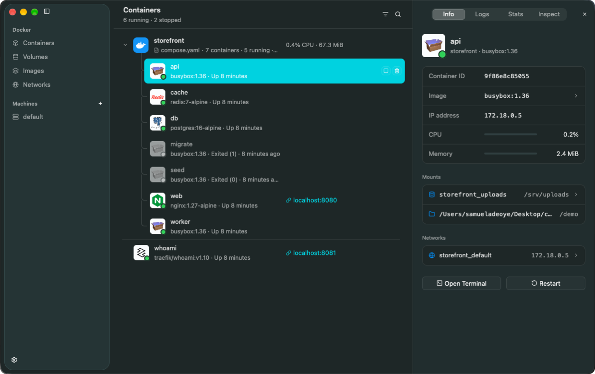
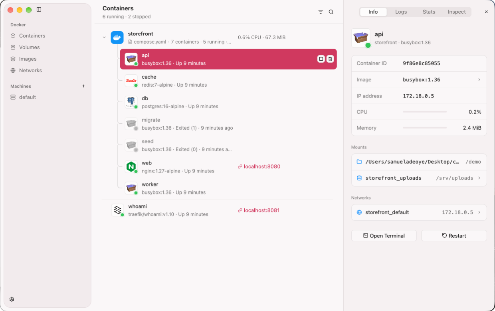
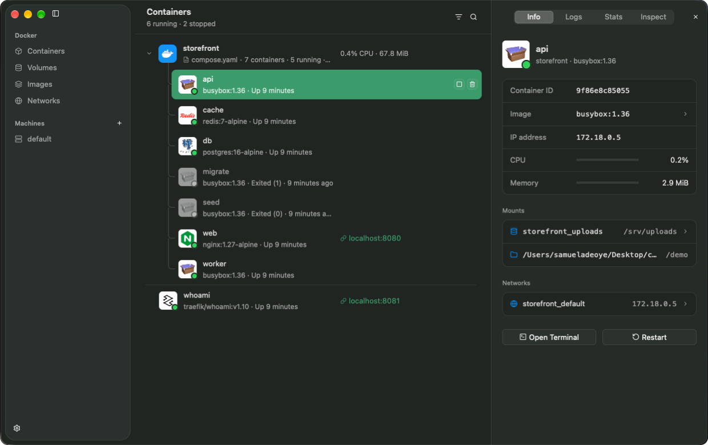
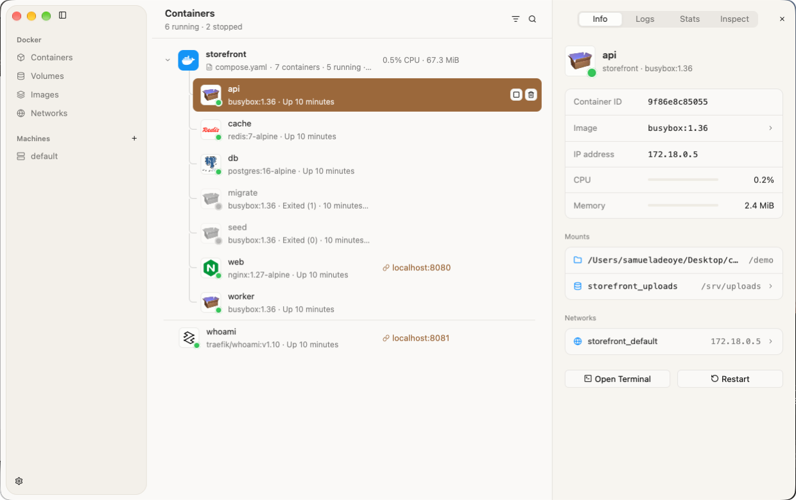
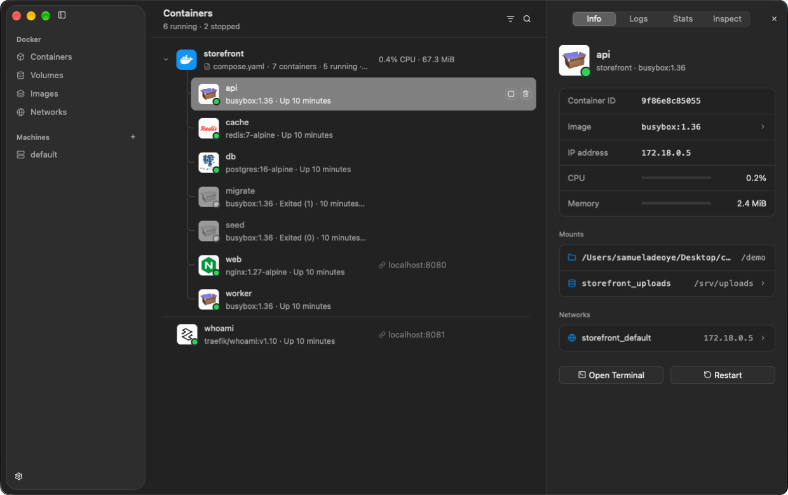
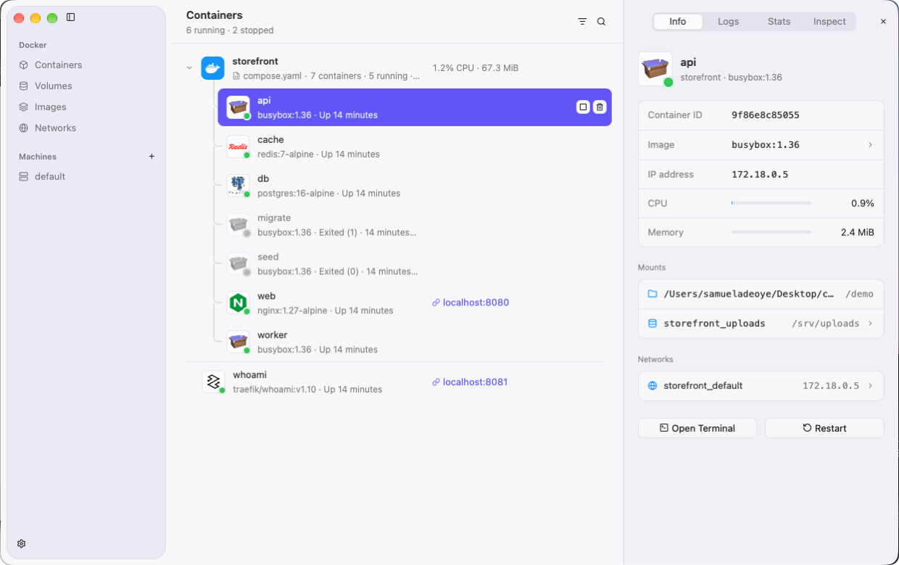
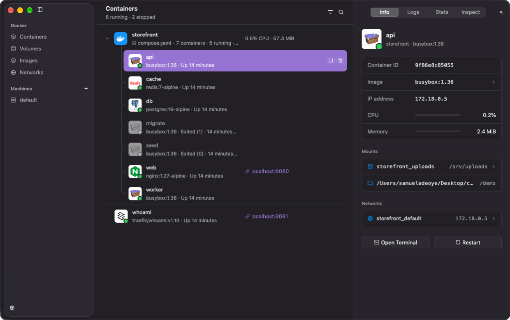

# Colima GUI

A native macOS app for [Colima](https://github.com/abiosoft/colima). Manage
your containers, volumes, images, and machines.

[Download](https://www.samayo.me/download/colima-gui)



| | |
| --- | --- |
|  |  |
|  |  |
|  |  |

## Build

```sh
cargo run
```
